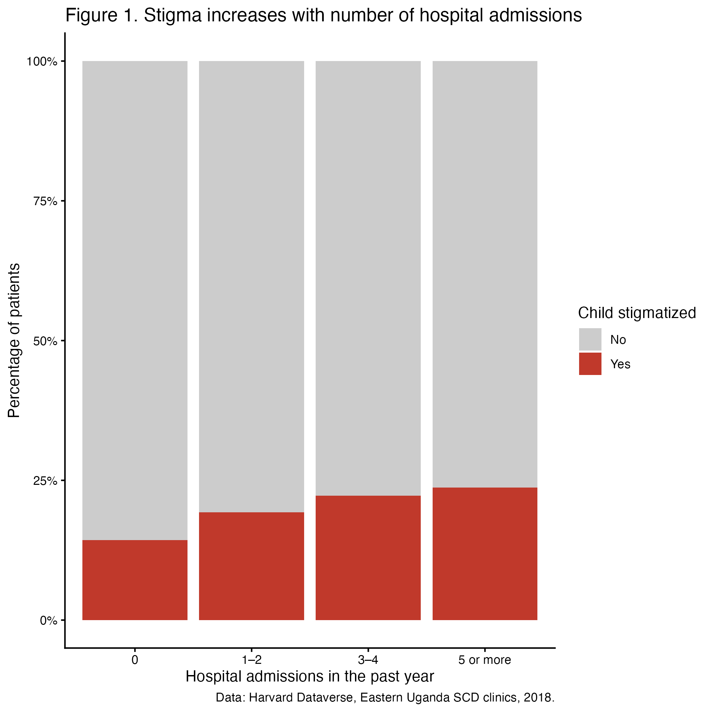

```{r, set-up, include=FALSE}
knitr::opts_chunk$set(echo = FALSE, message = FALSE, warning = FALSE)
```

```{r load in data}
here::i_am("project_2.Rmd")
data <- readRDS(
  file = here::here("data/clean_data.rds")
)
```

# Introduction

This report uses data from `r nrow(data)` patients with sickle cell disease
attending four clinics in eastern Uganda, (Mbale, Soroti, Atutur, and Ngora), 
February–August 2018 (Olupot-Olupot et al., 2020). The data set 
contains `r ncol(data)`
variables covering demographics, family history, hydroxyurea awareness,
hospital admissions, transfusions, symptoms, and stigma. The data is publicly 
available on [Harvard Dataverse](https://doi.org/10.7910/DVN/AIDN0V) 
(Ndila, 2020)

## Project Objectives

1. Describe the demographic profile of patients.
2. Estimate awareness and use of hydroxyurea.
3. Examine whether stigma is associated with illness burden.

## Results

```{r, table_one}
table_one <- readRDS(
  file = here::here("output/table_one.rds")
)
table_one
```

Table 1 summarizes the 1,794 patients. Most were young children, with roughly 
equal numbers of boys and girls. Patients were admitted a median of two times 
in the past year, and more than half needed a blood transfusion. Despite this 
heavy illness burden, only 6.4% of caregivers had heard of hydroxyurea, and 
just 2.3% of patients were taking it. About one in five children experienced 
stigma.
Compared with non-stigmatized children, stigmatized children were 
older (37% vs. 22% aged 10–17, p < 0.001), 
more often female (54% vs. 48%, p = 0.033), and had more 
hospital admissions (p < 0.001). Their caregivers were also more likely 
to have heard of hydroxyurea (9.3% vs. 5.7%, p = 0.012). Transfusion, 
family history, and hydroxyurea use did not differ significantly. 


```{r figure_one}
#| fig.align = "center",
#| out.width = "600px"
  

```


Figure 1 shows the percentage of children reported to be stigmatized, grouped 
by how many times they were hospitalized in the past year. Stigma rose with 
illness burden; 14% of children with no admissions were stigmatized, compared 
with 24% of those admitted five or more times. Because hydroxyurea reduces 
hospitalization, the low use of this medicine in this population may contribute
not only to illness burden but also to its social consequences.

However, the data is cross-sectional, so this claim attributes to association 
not cause and effect. 


# References

Ndila, C. (2020). *Data for: Characterising demographics, knowledge, practices
and clinical care among patients attending sickle cell disease clinics in
Eastern Uganda* (Version 2) [Data set]. Harvard Dataverse.
<https://doi.org/10.7910/DVN/AIDN0V>

Olupot-Olupot,P., Wabwire, H., Ndila, C., Adong, R., Ochen, L., Amorut, D.,
Abongo,G., Okalebo, C. B., Akello, S. R., Oketcho, J. B., Okiror, W., Asio, S.,
Odiit, A., Alaroker, F., Nyutu, G., Maitland, K., & Williams, T. N. (2020).
Characterising demographics, knowledge, practices and clinical care among
patients attending sickle cell disease clinics in Eastern Uganda. 87.
<https://doi.org/10.12688/wellcomeopenres.15847.2>
